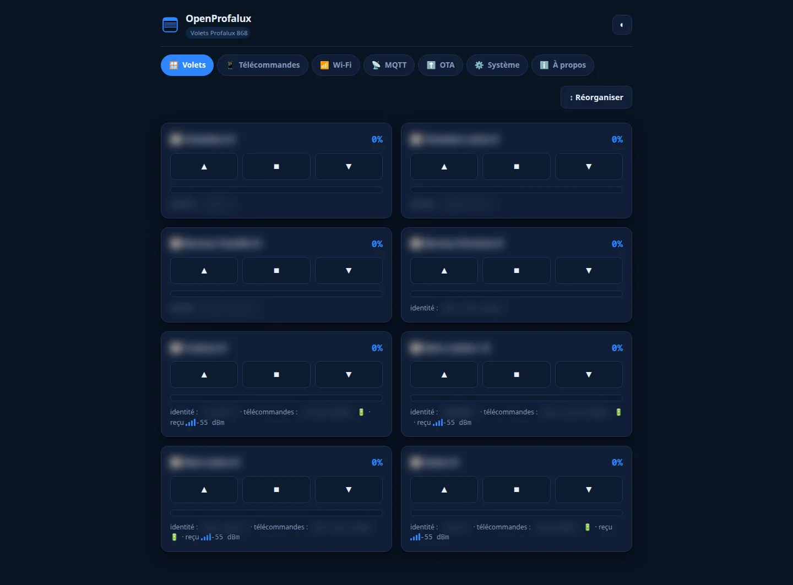
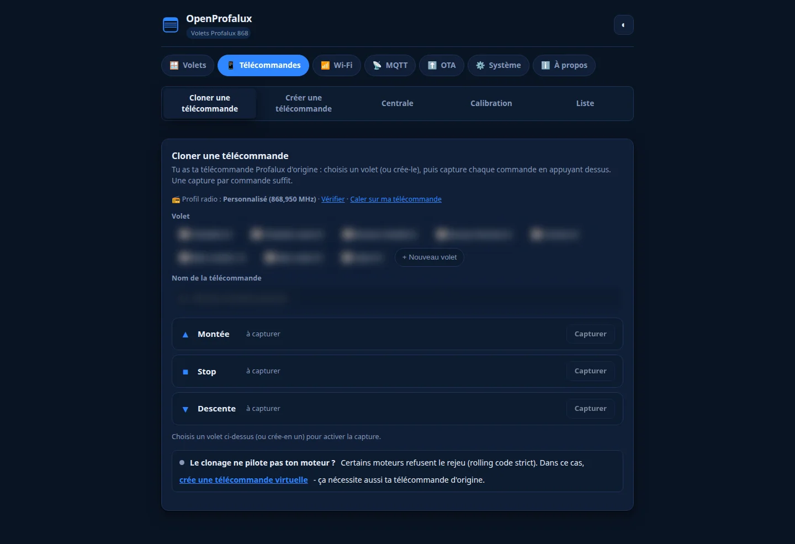
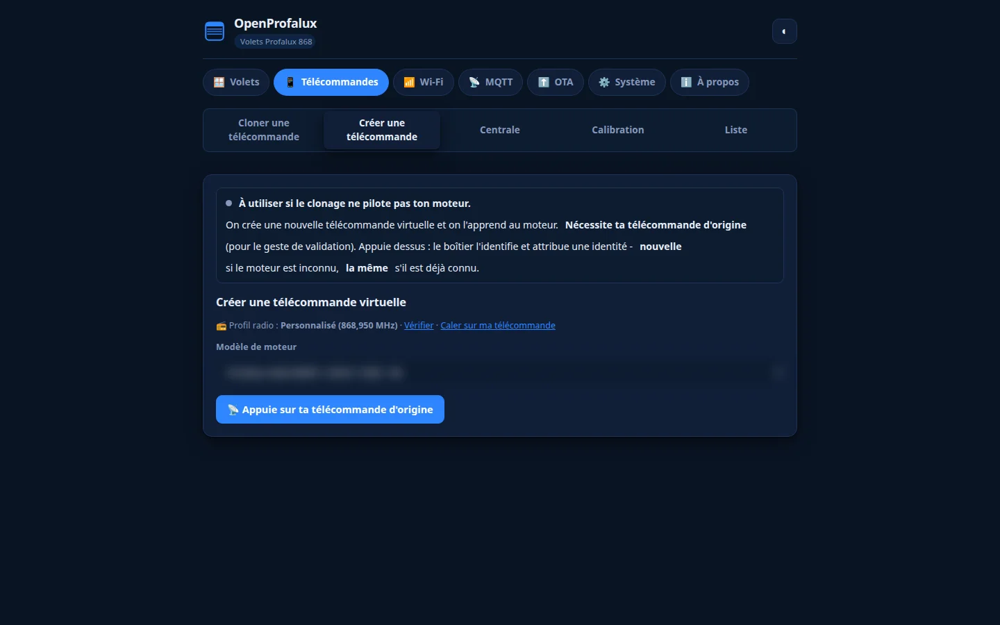
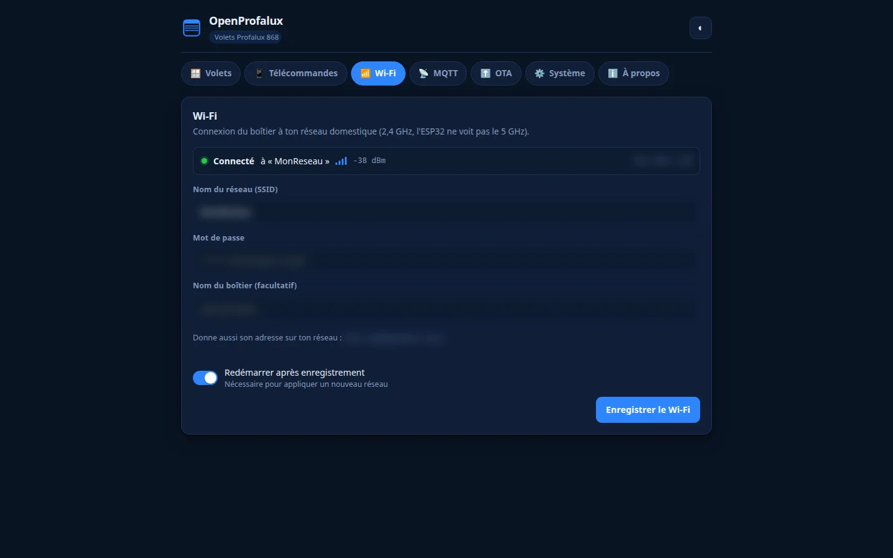
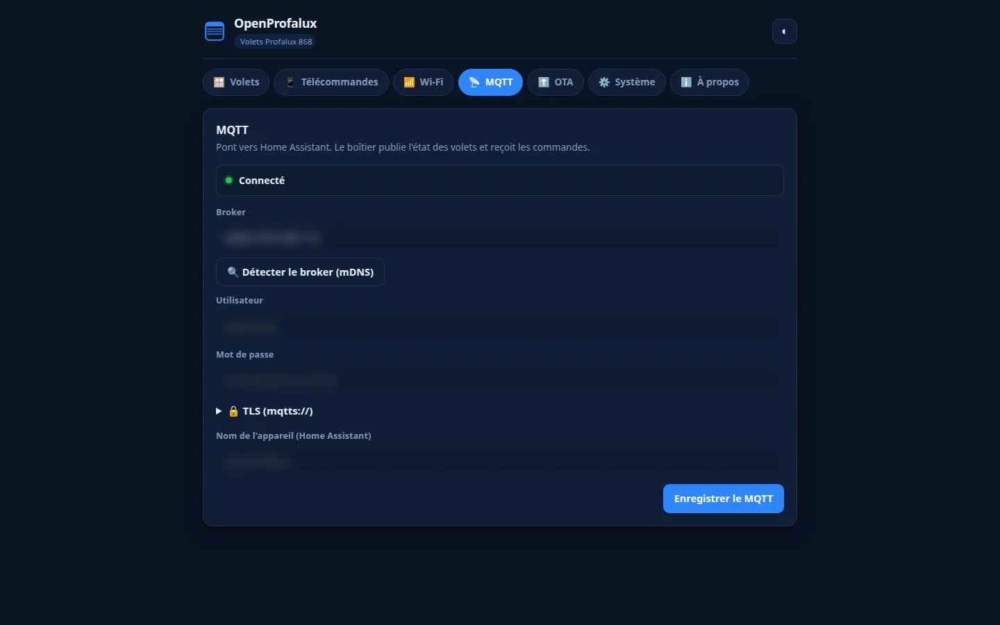
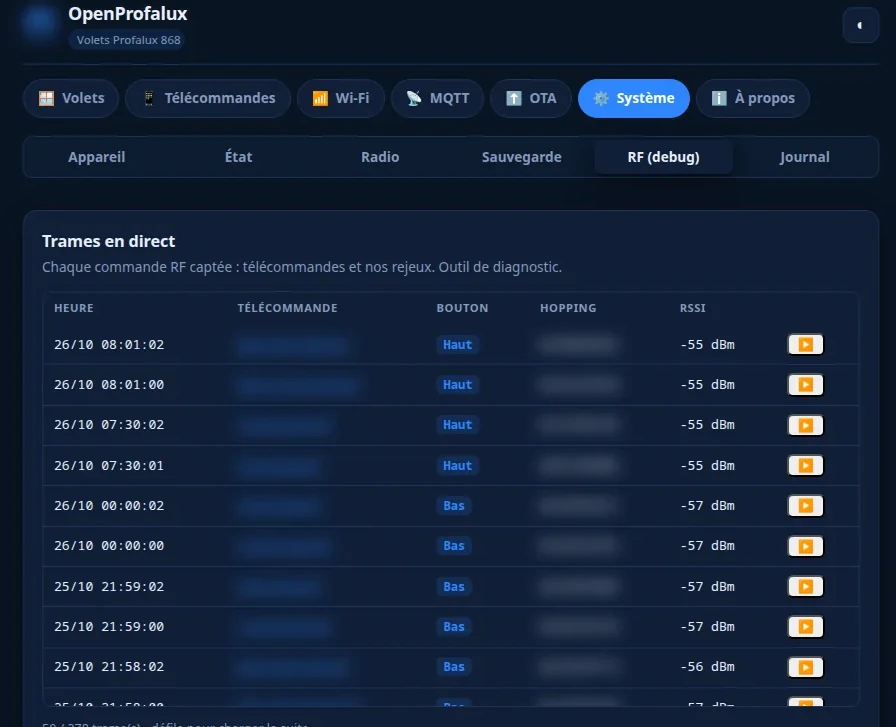

<p align="center">
  <picture>
    <source media="(prefers-color-scheme: dark)" srcset="docs/images/logo/banniere-sombre.webp">
    
  </picture>
</p>

**Piloter ses volets roulants Profalux depuis Home Assistant avec un ESP32 à ~15 €, sans la clé constructeur.**

Firmware ESP32 + CC1101 open-source pour les volets **Profalux 868 MHz** (moteurs MAI-EMPX /
MAI-EMNOE). Tout reste local : pas de cloud, pas de passerelle propriétaire, aucun fil à tirer.

Le cœur, c'est Profalux (volets roulants). Le même boîtier pilote aussi des **portails CAME**
(433,92 MHz, par rejeu) et sait émettre en **Somfy RTS (433,42 MHz)**, pour un foyer qui mélange
les marques. Un dernier protocole, l'**io-homecontrol** (Velux, Somfy io), est à l'étude. Somfy RTS
et io restent **expérimentaux** : détails plus bas.

📖 **Montage pas à pas, photos et l'histoire complète du reverse** : [www.isno.fr/projets/openprofalux](https://www.isno.fr/projets/openprofalux)

🔌 **Sans rien câbler** : je fais fabriquer une carte qui intègre tout d'origine (ESP32-S3, radio 868 MHz, antenne SMA, USB-C, protections ESD) et qui tourne avec ce même firmware. Prototypes en fabrication, pas encore en vente : [liste d'attente sur isno.fr](https://www.isno.fr/liste-attente).

## Le principe : cloner une télécommande, pas casser la crypto

Les télécommandes Profalux sont en KeeLoq (rolling code), donc une trame est a priori
impossible à rejouer. J'ai passé des jours à chasser la clé constructeur... avant de tester la
chose la plus bête, celle que j'aurais dû essayer en premier :

> **Le moteur accepte une trame rejouée.** Le compteur anti-rejeu n'est **pas** vérifié par le
> récepteur : une trame capturée puis réémise fait bouger le volet, même après avoir utilisé la
> vraie télécommande entre-temps. Donc **aucune clé n'est nécessaire** pour piloter par rejeu.

OpenProfalux **clone** donc une télécommande, sans crypto : on capture les trames ▲ / ■ / ▼
d'une vraie télécommande, on les nomme, et on les rejoue à la demande depuis Home Assistant.
C'est tout. La clé constructeur, explorée longuement (cf. `firmware-capture-test/` et `docs/`),
s'est révélée inutile pour piloter par rejeu.

## Deux méthodes de pilotage

- **Rejeu** : capturer une commande de la vraie télécommande, puis la réémettre. Aucune clé, et
  ça fonctionne dès qu'une télécommande d'origine est à portée du boîtier.
- **Enrôlement** : après avoir capté une fois la télécommande d'origine du volet, le boîtier crée
  sa propre identité que le moteur apprend, puis génère lui-même ses trames à code tournant. Il n'a
  plus besoin de rejouer les trames captées, et selon la génération du moteur c'est la méthode la
  plus fiable.

Le choix dépend du moteur : voir la compatibilité ci-dessous.

## Compatibilité

Matériel confirmé par des retours d'utilisateurs (conditions et détails dans
[docs/COMPATIBILITE.md](docs/COMPATIBILITE.md)) :

| Marque | Modèles | Méthode confirmée |
|---|---|---|
| Profalux | gamme PFX, NeoSol S300, moteur solaire MOT-PX3R10 | rejeu et/ou enrôlement selon la génération |
| Eveno | Zuni-R | rejeu (profil radio Eveno, 868,33 MHz) |
| FranciaFlex | M4G | enrôlement (le moteur limite le nombre de télécommandes) |
| CAME (portails) | récepteur AF43S + télécommande TOP-432 | rejeu (code fixe OOK, 433,92 MHz) |

La porteuse Profalux varie selon la génération (**868,350 à 868,425 MHz**). Pour un volet
ancien ou une autre marque, un profil radio ou une fréquence personnalisée se règle dans l'UI
(symptômes et marche à suivre dans [docs/COMPATIBILITE.md](docs/COMPATIBILITE.md)).

### Somfy RTS et io-homecontrol (expérimental)

Le même boîtier sait émettre deux autres protocoles, encore **en test**, à côté du cœur Profalux :

- **Somfy RTS** (433,42 MHz, [#73](https://github.com/Isno-Open/OpenProfalux/issues/73)) : on crée
  un volet virtuel (adresse 24 bits + code tournant), on l'appaire au moteur par son bouton PROG,
  puis on le pilote. L'émission reproduit l'appui bref de la télécommande d'origine (rafale courte) :
  c'est ça qui déclenche la course complète, y compris sur les récepteurs à lames orientables (BSO),
  où un appui long oriente les lames au lieu de faire la course. Validé sur un récepteur Soliris
  Mod/Var ; reste à confirmer sur d'autres.
- **io-homecontrol** (Velux, Somfy io, [#87](https://github.com/Isno-Open/OpenProfalux/issues/87)) :
  en recherche, **pas encore fonctionnel**. La trame d'appairage émise est conforme à celle d'une
  vraie télécommande, mais le moteur ne l'a pas encore validée sur le terrain ; le diagnostic est en
  cours (moment d'émission par rapport à la fin de la mise en programmation, portée).

## Ce que fait le firmware (`firmware/`)

- **Home Assistant** (MQTT discovery) : un *cover* par volet (ouvrir / fermer / stop / position), plus une entité **mise à jour firmware**, un interrupteur **écoute RF**, un capteur **dernière trame** et le **niveau de pile** par télécommande. MQTT en clair ou TLS.
- **UI web embarquée** : pilotage, apprentissage, calibration, moniteur RF, config.
- **Apprentissage** : capture ▲/▼/■ d'une vraie télécommande, ou enrôlement d'un volet.
- **Position** estimée par le temps (calibration montée/descente, recalage aux butées).
- **Suivi de la vraie télécommande** : ▲/▼ lance le moteur, ■ fige (modèle appui + stop).
- **Multi-télécommandes** par volet.
- **Sauvegarde / restauration** de la config (noms + trames de référence + calibration).
- **OTA** : upload web, pull MQTT, **vérification de la dernière version sur GitHub**, et **retour automatique** si une image ne démarre pas (2 partitions).
- **Capture de trames** optionnelle vers MQTT (dédup par serial).
- **Volets et portails** : le type se règle par appareil (un volet monte/descend, un portail ouvre/ferme).
- **Rejeu brut** (OOK) pour les codes fixes : portails **CAME**, télécommandes 433 simples, sans décoder le protocole.
- **Profils radio par appareil** : fréquence, répétition et préréglage de marque réglés volet par volet (plusieurs marques sur une même radio sans se gêner), avec « Caler sur ma télécommande » (balayage RSSI).
- **Centrale** : commander un groupe de volets ensemble.

> **Portée pendant l'apprentissage.** La capture d'une télécommande et l'enrôlement d'un
> volet passent par la radio : garde la télécommande d'origine (et le volet) à portée du
> boîtier pendant ces étapes. Une fois le volet mémorisé, le pilotage se fait à distance.

→ Détails, build et flash : **[`firmware/README.md`](firmware/README.md)**.

Sur Mac, une procédure testée installe ESP-IDF v6.1 en natif (pas de Docker USB capricieux) :
**[`docs/FLASH-MACOS.md`](docs/FLASH-MACOS.md)**.

## L'interface web

Servie par l'ESP32, sans aucune application : pilotage des volets, apprentissage,
calibration, moniteur RF et configuration Wi-Fi / MQTT.

<table>
  <tr>
    <td width="50%"><br><sub><b>Volets</b> : une carte par volet, position estimée.</sub></td>
    <td width="50%"><br><sub><b>Rejeu</b> : capture ▲/■/▼ d'une vraie télécommande.</sub></td>
  </tr>
  <tr>
    <td><br><sub><b>Enrôlement</b> : identité virtuelle apprise au moteur.</sub></td>
    <td><br><sub><b>Wi-Fi</b> : connexion du boîtier au réseau.</sub></td>
  </tr>
  <tr>
    <td><br><sub><b>MQTT</b> : broker et discovery vers Home Assistant.</sub></td>
    <td><br><sub><b>Moniteur RF</b> : chaque trame reçue (bits, RSSI, KeeLoq).</sub></td>
  </tr>
</table>

> Les captures des sept onglets, en versions PC et mobile, sont dans [`images/ui/`](images/ui/).

## Matériel

| Composant | Réf | Coût |
|-----------|-----|------|
| ESP32 (M5Stack ATOM Lite ou DevKit) | ESP32-WROOM / PICO | ~5 à 12 € |
| Module CC1101 868 MHz | petit module vert 868 (pastilles au pas de 2 mm, pas le 2,54) | ~3 € |
| Antenne 868 MHz | fil 8,6 cm quart d'onde, ou hélicoïdale SMA | ~2 € |

**CC1101 = 3,3 V max, jamais 5 V.** Fréquence selon la génération du volet (voir Compatibilité).

## Cartes et construction

Le brochage ne vit pas dans le code : chaque carte est déclarée dans
`boards/<carte>.json`, et `tools/gen_board.py` en engendre `board_pins.h` à la
configuration CMake (rien d'engendré n'est commis). Le firmware **lit** ces
broches, il n'en connaît aucune. Ajouter une carte, c'est ajouter un
`boards/<nom>.json`.

| `-DBOARD=` | Carte | Cible IDF |
|---|---|---|
| `isno-super` | ISNO Super (ESP32-S3-MINI-1-N8, CC1101 868 intégré) | `esp32s3` |
| `external` | ESP32-WROOM DevKit + CC1101 externe | `esp32` |
| `d1-mini` | D1 mini ESP32 + CC1101 externe (GDO0 sur IO26, SPI 1 MHz) | `esp32` |
| `m5-atom-lite` | M5Stack ATOM Lite + CC1101 en Dupont | `esp32` |
| `esp32-poe` | Olimex ESP32-POE + CC1101 externe (Ethernet LAN8720 en plus du Wi-Fi) | `esp32` |
| `arduino-nano-esp32` | Arduino Nano ESP32 + CC1101 externe (SPI sur D10-D13, GDO0 sur D2) | `esp32s3` |
| `xiao-esp32c3` | Seeed XIAO ESP32C3 + CC1101 868 externe (module M115 soudé) | `esp32c3` |
| `lilygo-t-embed-cc1101` | LILYGO T-Embed (CC1101 868 intégré, écran TFT + SD sur le même bus SPI, [#112](https://github.com/Isno-Open/OpenProfalux/issues/112)) | `esp32s3` |
| `xiao-esp32s3` | Seeed XIAO ESP32S3 + CC1101 868 externe (dépannage, [#1](https://github.com/Isno-Open/OpenProfalux/issues/1)) | `esp32s3` |

```bash
cd firmware
idf.py -B build -DSDKCONFIG=build/sdkconfig -DIDF_TARGET=esp32s3 -DBOARD=isno-super build
```

`isno-super.json` est une **copie** de la source de vérité
`isno-launcher/boards/isno-super.json` : une copie inévitable se vérifie, elle
ne se tient pas à la main.

## Structure du dépôt

| Dossier | Rôle |
|---------|------|
| `firmware/` | **Firmware produit** : cover HA, UI, clone/replay, enrôlement, OTA, sauvegarde |
| `firmware/test/` | Bancs de test hôte (PC) : KeeLoq, confirmation RX, Somfy, persistance, OTA |
| `firmware-capture-test/` | Firmware de **banc / reverse** : capture RF, tests KeeLoq, mesures |
| `boards/` | Déclaration des cartes (`<carte>.json`), lue par le firmware |
| `docs/` | Architecture, mesures RF, compatibilité, synthèses de la recherche |
| `research/` | Notes et données brutes de la recherche |
| `sim/` | Harness de vérification KeeLoq (cipher + codec) côté PC |
| `tools/` | Scripts (génération des broches, vérifications CI) |

## Statut

- ✅ Firmware produit **compile** (ESP-IDF v6.1, 1,14 Mo pour `isno-super`, 24 % libres au 2026-10-18, partitions OTA).
- ✅ **Rejeu validé au banc** (le moteur suit une trame rejouée, y compris après la vraie télécommande).
- ✅ **Enrôlement confirmé par des utilisateurs** (NeoSol S300, moteur solaire MOT-PX3R10, FranciaFlex M4G).
- ✅ **Portails CAME (433 MHz)** par rejeu : validé sur un portail réel (retour Pascal/lecanard38, [#102](https://github.com/Isno-Open/OpenProfalux/issues/102)).
- 🧪 **Somfy RTS (433 MHz)** émis : appairage PROG, pilotage, rafale courte (course complète). Validé sur un récepteur à lames orientables, à confirmer plus largement ([#73](https://github.com/Isno-Open/OpenProfalux/issues/73)).
- 🔬 **io-homecontrol** (Velux, Somfy io) à l'étude, pas encore fonctionnel ([#87](https://github.com/Isno-Open/OpenProfalux/issues/87)).
- ⏳ À valider sur l'installation : calibration des temps de course, portée antenne, multi-volets.

## Extensions possibles

Même approche (capture + rejeu) potentiellement applicable à d'autres volets 868 MHz à
rolling code non contraint (Delta Dore X2D, France Fermetures LIBRIO…), non vérifié.
