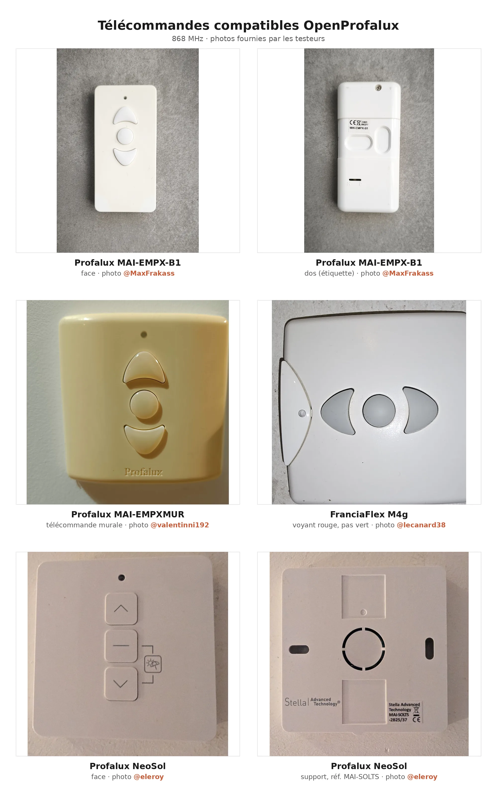

# Matériel compatible

Liste du matériel testé avec OpenProfalux, tenue à partir des retours (forum, issues).
Une ligne = un retour vérifié.

*Quelques télécommandes confirmées par les testeurs. Photos : @MaxFrakass, @valentinni192, @lecanard38.*

- **rejeu** : capturer une commande de la télécommande d'origine puis la réémettre.
- **enrôlement** : créer une identité que le moteur apprend, pour piloter sans capturer.

| Marque | Modèle | Fréquence | Méthode | Retour |
|---|---|---|---|---|
| Profalux | gamme PFX (référence du projet) | 868,350 à 868,425 MHz selon la génération | rejeu, enrôlement | #34 |
| Profalux | NeoSol S300 Stella AT | ~868,383 MHz (personnalisée, à confirmer) ; bit de répétition | enrôlement | #1 |
| Profalux | MOT-PX3R10 (moteur solaire) | 868 MHz, bit de répétition | enrôlement | #59 |
| Profalux | JX02XE 10R-56 (Stella NeoSol, solaire) | 868 MHz, bit de répétition | enrôlement | #59 |
| Profalux | VISIO Monobloc (MAI-EMPX-B1) | 868,350 MHz, profil R6 | enrôlement (rejeu KO ici) | #35 |
| Eveno | Zuni-R | 868,33 MHz (profil Eveno) | rejeu | #3 |
| FranciaFlex | M4G | 868 MHz | enrôlement | forum HACF |
| Somfy | récepteur Soliris RTS + moteur J4 WT | 433,42 MHz (Somfy RTS) | appairage PROG, appui bref | #73 |

Un retour à ajouter ? Ouvrez une issue avec la marque, le modèle, l'année d'installation,
la fréquence, le profil radio choisi, la carte et le module utilisés, et ce qui a fonctionné
(rejeu, enrôlement, ou les deux).

## Particularités connues

**Enrôlement, les deux signes à connaître (aller-retour et délai).** À la fin de
l'apprentissage, deux choses trompent souvent :

- **l'aller-retour de confirmation est facultatif.** Certains moteurs font un petit
  aller-retour pour signaler « c'est appris », d'autres ne bougent pas du tout. Les deux
  cas sont normaux : l'absence d'aller-retour ne veut pas dire que l'enrôlement a échoué.
- **il faut attendre une dizaine de secondes avant de tester une commande.** Le moteur ne
  répond pas immédiatement ; tester tout de suite donne l'impression d'un échec alors que
  l'enrôlement a réussi. C'est le piège le plus fréquent.

Retours concordants : lecanard38 sur FranciaFlex M4G (« si on teste sans attendre, ça ne
marche pas », et pas d'aller-retour sur ce moteur), eleroy sur NeoSol S300 (issue #1) et
joha38 sur moteur solaire (issue #59). Le délai est encore plus marqué sur les moteurs
solaires, qui n'écoutent la radio que par intermittence pour économiser leur batterie.

**NeoSol et moteurs solaires, bit de répétition** : sur NeoSol S300 et sur les moteurs
solaires Profalux, l'enrôlement et le pilotage sont plus fiables en cochant **« Émettre
comme la télécommande (bit de répétition) »** (Système > Appareil), fréquence Profalux par
défaut. Retours concordants : eleroy sur NeoSol 300 (issue #1), joha38 sur MOT-PX3R10
solaire de 2020 (issue #59, confirmé sur deux modules radio) et, chez le même testeur, sur
un moteur solaire récent **JX02XE 10R-56 (Stella NeoSol) de 2026**. La même méthode, preset
NeoSol et bit de répétition, pilote les quatre volets, anciens et récents mélangés.

⚠️ À confirmer, fréquence du NeoSol S300 Stella : un second retour sur ce moteur n'a réussi
l'enrôlement qu'en **forçant une fréquence personnalisée autour de 868,383 MHz** (profil
NeoSol R8), le défaut Profalux (868,425) ne captant pas sa télécommande. Le bouton **« Caler
sur ma télécommande »** donne la valeur exacte à viser. Valeur à confirmer sur d'autres
exemplaires.

**FranciaFlex M4G** : le moteur n'accepte qu'un **nombre limité de télécommandes**. Une
fois ce nombre atteint, l'enrôlement d'un nouvel émetteur échoue sans message, et il faut
réinitialiser le moteur pour repartir.

Un signe utile pour s'en assurer : la télécommande d'origine d'un volet saturé continue
d'**apparaître dans le journal radio** du boîtier, sous le nom qu'on lui avait donné. La
réception fonctionne donc, c'est bien le moteur qui refuse. Si l'enrôlement échoue alors
que les trames arrivent, chercher du côté du moteur et non du boîtier.

Même moteur, deux points où la procédure d'enrôlement diffère de celle décrite au départ :
le volet doit être **descendu de quelques lames** et non en butée haute, et le moteur ne
fait **pas d'aller-retour de confirmation** à la fin.

**Eveno Zuni-R** : les télécommandes émettent à **868,33 MHz**, environ 100 kHz sous
Profalux (868,425 MHz), au bord de la bande passante de réception. Avec le profil Profalux,
elles ne sont pas captées, même collées à l'antenne. Choisir le profil radio **Eveno** dans
Système > Appareil (ou `"radio_profile":"eveno"` dans `POST /api/config`). Pour une autre
marque, le profil **personnalisé** prend une fréquence en kHz, dans la plage autorisée de la
carte.

**Profalux, fréquence selon la génération** : la porteuse Profalux n'est pas unique, elle a
baissé au fil des générations. Récente ≈ **868,425 MHz** (profil `profalux` par défaut), vers
2011-2012 ≈ **868,400 MHz**, plus anciennes ≈ **868,350 MHz**. Symptôme typique : le boîtier
capte quelque chose (RSSI fort, log « entête HCS OK mais N bits »), mais aucune trame
complète, et seules les télécommandes récentes s'apprennent. Dans ce cas, choisir
**Fréquence personnalisée** dans Système > Appareil et essayer **868350** puis **868400**, en
relançant l'apprentissage à chaque valeur, télécommande près de l'antenne. Une fois
l'identité captée, le pilotage fonctionne même revenu sur le profil Profalux. (issue #34 :
valentinni192 capté à 868,400 ; marcusboludo, 9 anciens volets, à 868,350.) Autre retour,
issue #59 : joha38, deux volets dont la télécommande MAI-EMPX-B1 n'était pas détectée au
défaut ; le calage automatique a trouvé **868,320 MHz**, l'enrôlement a réussi à cette
valeur, puis les quatre volets ont continué de répondre une fois revenu sur le profil
Profalux. Le calage de fréquence (Système > Appareil) est donc le bon réflexe quand une
télécommande ne se capte pas au défaut.

## À compléter

- Modèles **Profalux** précis validés par le mainteneur, à détailler.
