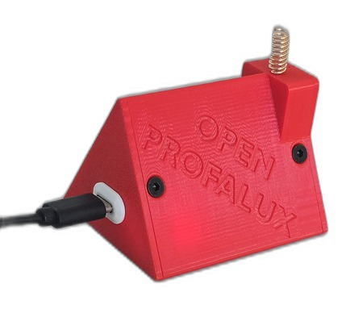

# Boitier imprime 3D pour OpenProfalux

Un boitier en forme de petite maison pour loger la carte (ESP32 + CC1101), avec le logo
OPEN PROFALUX en relief, le passage d'antenne et l'ouverture USB-C.

Concu et imprime par @lecanard38, partage avec son accord.

## Fichiers

- `OPENPROFALUX.f3d` : source Fusion 360, editable.
- `OPENPROFALUX-boite.step`, `OPENPROFALUX-avant.step`, `OPENPROFALUX-arriere.step` :
  export STEP, format neutre editable dans n'importe quelle CAO.
- `Ensemble.stl` : maillage pret a imprimer.
- `openprofalux-maison.jpg` : photo du boitier imprime, detouree sur fond blanc.
- `openprofalux-maison-transparent.png` : la meme, fond transparent.

## Licence

CC BY-SA 4.0. Credit : @lecanard38. Si vous le reprenez ou le faites evoluer, gardez le
credit et la meme licence, et n'hesitez pas a partager le resultat.
